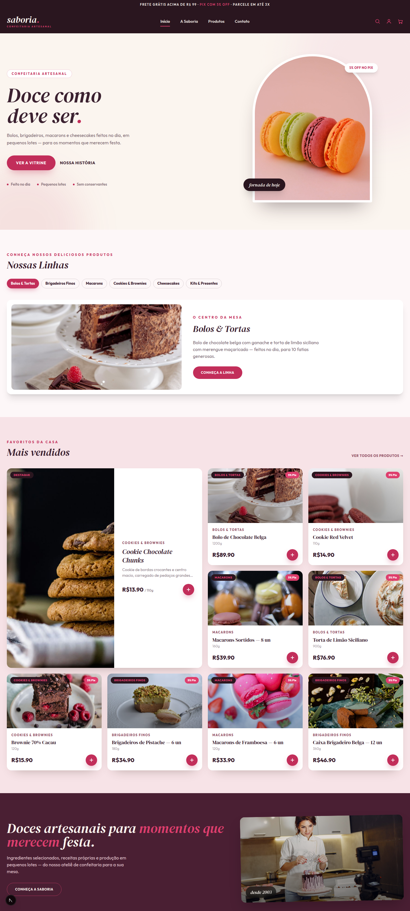
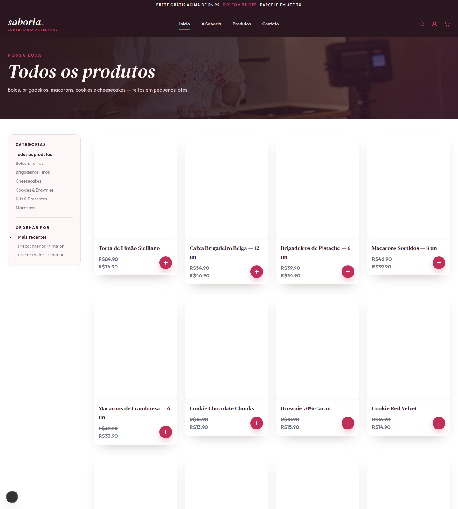
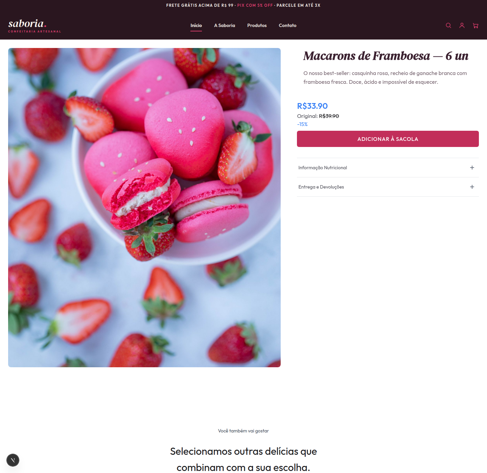
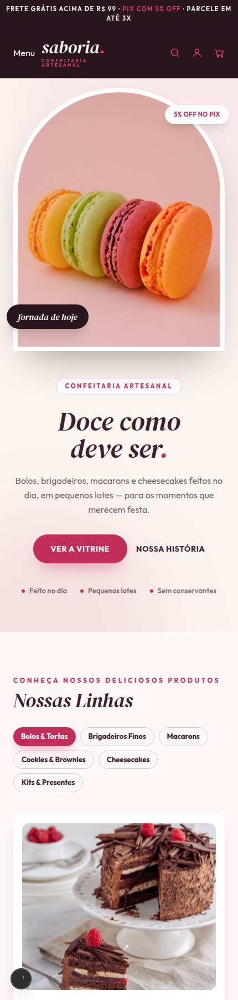

# Saboria Commerce


[English](README.md) · **Português (Brasil)**

E-commerce headless full-stack da **Saboria**, uma confeitaria artesanal fictícia: backend **Medusa 2** e storefront **Next.js (App Router)** totalmente customizado, num monorepo Turborepo — loja em pt-BR, preços em BRL com price list "de/por", modelo de produto realista (informação nutricional, alergênicos, validade) e ambiente local que sobe com dois comandos.



| Loja | Página de produto | Mobile |
|---|---|---|
|  |  |  |

## Lighthouse

Medido no build de produção (`next build` + `next start`), homepage `/br`:

| | Performance | Acessibilidade | Best Practices | SEO |
|---|---|---|---|---|
| Desktop | **100** | 94 | **100** | 91 |
| Mobile | **90** | 94 | **100** | 91 |

Core Web Vitals (mobile): FCP 1,0 s · LCP 3,5 s · TBT 80 ms · **CLS 0**.

## Stack

| Camada | Tecnologia |
|---|---|
| Backend | [Medusa 2.16](https://medusajs.com) (Node 20+, Postgres, cache/event-bus/workflow-engine em Redis) |
| Storefront | Next.js 15 App Router, Tailwind CSS, [OpenNext](https://opennext.js.org/cloudflare) para Cloudflare Workers |
| Monorepo | Turborepo + npm workspaces |
| Infra (local) | Docker Compose (Postgres 16, Redis 7) |

## Funcionalidades

- Catálogo com 6 linhas e 13 produtos seedados de um único JSON (seed idempotente);
- **Preço "de/por"** via price lists do Medusa — preço original riscado e badge de desconto na PDP;
- Modelo de produto com **informação nutricional, alergênicos, flags de glúten/lactose e validade** (abas na PDP);
- Carrinho com mini-dropdown no header, add-to-cart direto nos cards e checkout completo (região BR, frete padrão/expresso);
- Design system próprio: paleta framboesa-sobre-chocolate, DM Serif Display + Outfit, hero com vitrine em arco;
- Loja em pt-BR, moeda BRL, roteamento de região `/br`;
- **Cache incremental em KV** no build OpenNext para páginas de catálogo, com dados por usuário em `no-store` ([ADR 0003](docs/adr/0003-opennext-incremental-cache.md));
- Cache, event bus e workflow engine em Redis, ativados automaticamente quando `REDIS_URL` existe.

## Início rápido

Requisitos: Node 20+, Docker.

```bash
# 1. infra (Postgres + Redis)
docker compose up -d

# 2. dependências
npm install

# 3. arquivos de ambiente
cp apps/backend/.env.template apps/backend/.env
cp apps/storefront/.env.template apps/storefront/.env.local

# 4. banco: migrações + base (região BR, frete, publishable key) + catálogo
npm run setup   -w @crevellari/backend
npm run seed    -w @crevellari/backend
npx medusa user -e admin@example.com -p supersecret \
  --prefix apps/backend   # login do admin

# 5. sobe os dois apps
npm run dev
```

O `npm run setup` imprime a `NEXT_PUBLIC_MEDUSA_PUBLISHABLE_KEY` — cole no `apps/storefront/.env.local` e acesse:

- Loja: http://localhost:8000
- Admin: http://localhost:9000/app

> O setup é **idempotente por etapa** (região, tax, estoque, frete, API key) — pode rodar de novo sem medo. O seed do catálogo apaga e recria os produtos, então também é seguro reexecutar.

## Scripts

| Comando | O que faz |
|---|---|
| `npm run dev` | Backend (`:9000`) + storefront (`:8000`) em dev via Turbo |
| `npm run build` | Build de produção dos dois apps |
| `npm run setup -w @crevellari/backend` | Bootstrap de base (região BR, tax, estoque, frete, publishable key) |
| `npm run seed -w @crevellari/backend` | Seed do catálogo a partir do `saboria-catalogo.json` |
| `npm run lint` | Lint dos dois apps |

## Arquitetura

```
apps/
├── backend/         Medusa 2 — API de commerce, admin, jobs
│   └── src/scripts/ setup.ts (bootstrap de base) · seed-saboria-real.ts (catálogo)
└── storefront/      Next.js App Router — src/modules/* por domínio
```

Decisões documentadas:

- [ADR 0001 — Commerce headless com Medusa](docs/adr/0001-headless-commerce-medusa.md)
- [ADR 0002 — Monorepo com Turborepo](docs/adr/0002-monorepo-turborepo.md)
- [ADR 0003 — Estratégia de cache incremental do OpenNext](docs/adr/0003-opennext-incremental-cache.md)

## Deploy

O ambiente de referência é local. O [DEPLOY.md](DEPLOY.md) documenta uma topologia de produção (storefront em Cloudflare Workers, Postgres/Redis gerenciados, mídia em S3) sem amarrar o projeto a nenhum provedor.

## Créditos

Fotografias de produto e cena do [Pexels](https://www.pexels.com) (Licença Pexels) — ver [CREDITS.md](CREDITS.md).

## Licença

[MIT](LICENSE) © Vinícius Augusto Crevellari
